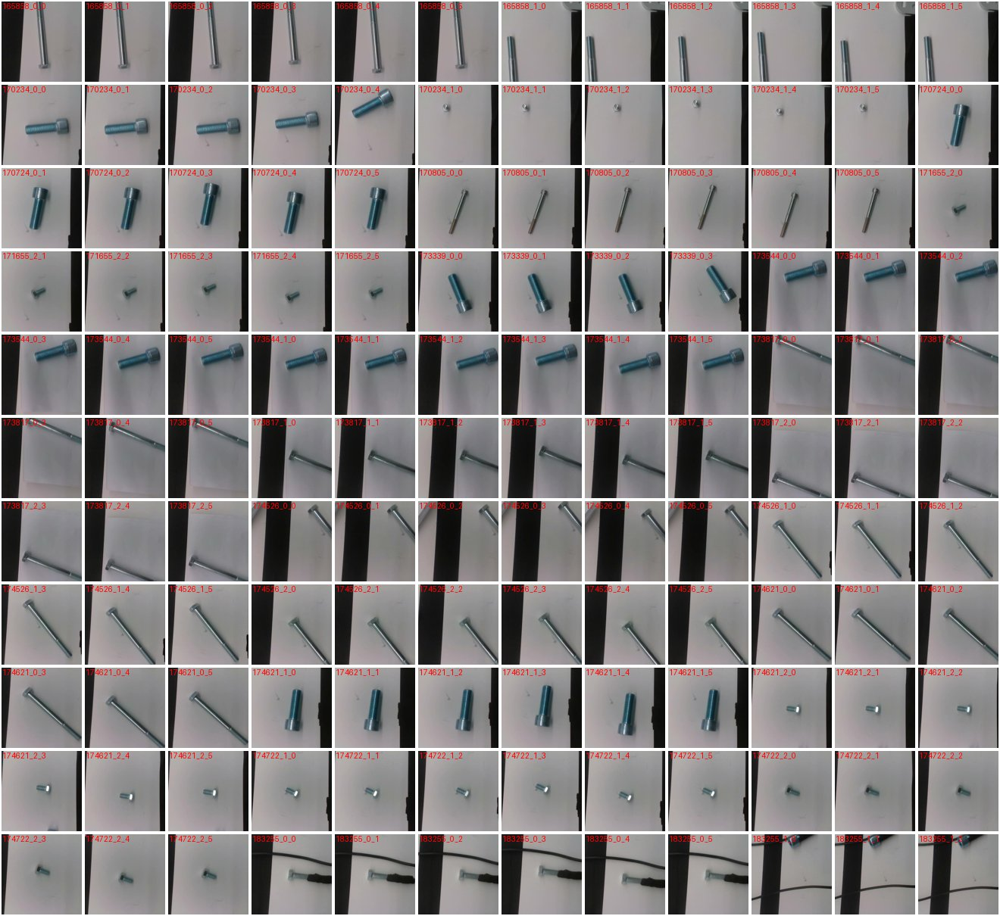
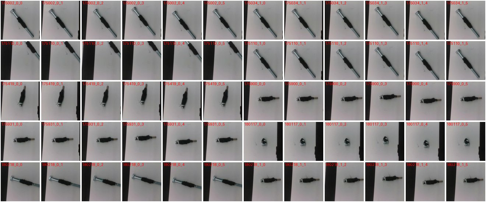
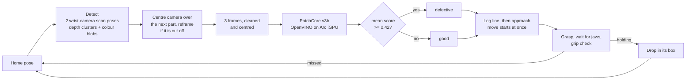
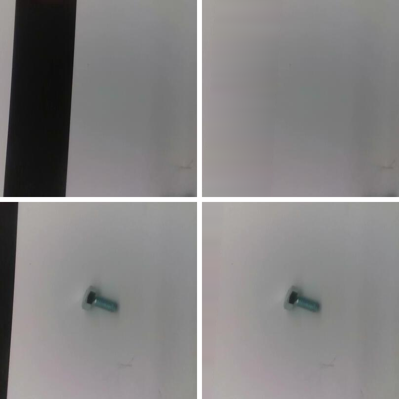
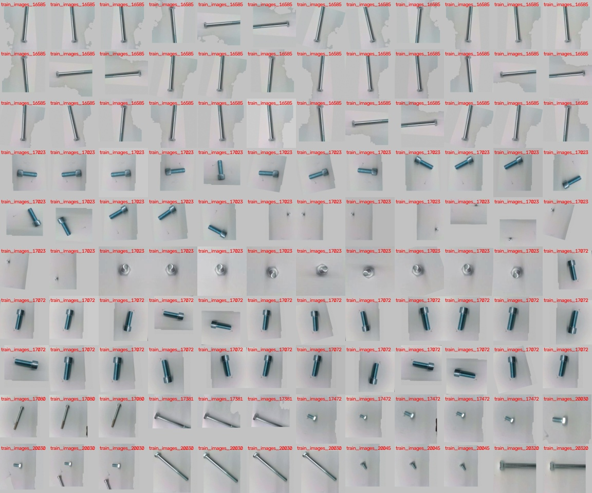
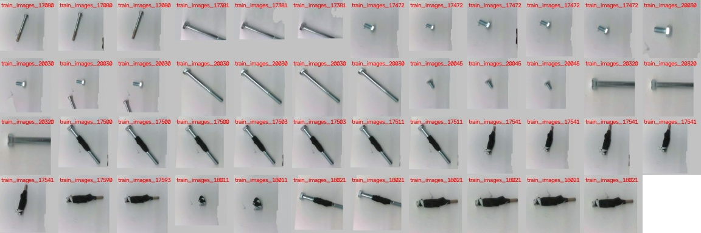

# armfarm14: Spot it, sort it

Track 3 entry for the Viam **Edge of Intelligence** robot hackathon (13 and 14 Nov 2026).

A UFactory xArm 850 with a wrist-mounted Intel RealSense finds fasteners on a paper strip, inspects each one up close, decides whether it is **good** or **anomalous**, and drops it into the matching box. Anomalies are not known in advance, so the model is trained on **good parts only** (one-class anomaly detection with PatchCore) and flags anything that does not look like them. Inference runs on the station's Intel Arc iGPU through OpenVINO.

<p align="center">
  
  
  <br><em>Raw wrist-camera captures: good parts (left, used for training) and tape-wrapped parts (right, used only for validation).</em>
</p>

## Contents

1. [How a run works](#how-a-run-works)
2. [Hardware and compute](#hardware-and-compute)
3. [Repository layout](#repository-layout)
4. [Setup](#setup)
5. [Running it](#running-it)
6. [Step 1: data collection](#step-1-data-collection)
7. [Step 2: preprocessing](#step-2-preprocessing)
8. [Step 3: building the dataset](#step-3-building-the-dataset)
9. [Step 4: training](#step-4-training)
10. [Step 5: deployment on the station](#step-5-deployment-on-the-station)
11. [Step 6: calibration](#step-6-calibration)
12. [Step 7: the sorting loop](#step-7-the-sorting-loop)
13. [Logging, latency and metrics](#logging-latency-and-metrics)
14. [Optional: Claude review](#optional-claude-review)
15. [Results](#results)
16. [What failed, and what we would change](#what-failed-and-what-we-would-change)

## How a run works



The robot handles one part per loop and re-detects from home every time. If a judge moves a part mid-run, the next detection simply finds it at its new position.

## Hardware and compute

| Item | Use |
| --- | --- |
| UFactory xArm 850 + two-finger gripper | Picking and placing |
| Intel RealSense D435 on the wrist (`cam`) | Detection (depth + colour) and close-up inspection |
| USB webcam on a stand (`overview-cam`) | Optional scene camera (off by default, see calibration) |
| Intel Core Ultra X7 358H station, Arc B390 iGPU | Runs viam-server and the anomaly model |
| Windows laptop | Runs the control script against the machine over the Viam SDK |

| Stage | Runs on |
| --- | --- |
| Anomaly scoring (PatchCore, OpenVINO IR, f32) | **Arc B390 iGPU** (`execution_devices=['GPU.0']`), about 114 ms per frame |
| Depth clustering (`erh:vmodutils` pc-cluster) | Station CPU, inside viam-server |
| Colour segmentation, image cleaning (OpenCV) | Laptop CPU |
| Model training | Viam cloud training (anomalib-train, CUDA) |

## Repository layout

```
track3_sort.py        Main program: detect, inspect, decide, pick, sort, log
run_track3.bat/.ps1   One-click launcher (sets up the venv, loads keys, plan then run)
test_inspect.py       Inspection-only test (no picking): scores every part, saves images
run_test.bat/.ps1     Launcher for test_inspect.py
run_capture.bat/.ps1  Training-data capture launcher
run_metrics.py        Per-run timings, latency, inference device, summary
overview.py           Overview-camera helpers (pixel to table mapping, part finding)
overview_calib.json   Overview-camera calibration (homography + reference frame)
overview_ref.jpg      Reference frame the overview camera registers against
agent_review.py       Optional Claude second opinion (off by default)
prep/                 Dataset pipeline: preprocess, build, external data, upload, threshold
experiments/          Day-1 colour-guided pick scripts (not used by Track 3)
docs/images/          Images used in this README
viam_keys.ps1.example       Template for Viam API credentials
anthropic_key.ps1.example   Template for the optional Claude key
```

Not committed (see `.gitignore`): credentials, raw and prepared image folders, and everything a run writes (`runs/`, `test_runs/`, `grasp_checks/`, `track3_log.csv`).

## Setup

1. Install Python 3.10+ on Windows ("Add to PATH").
2. Copy `viam_keys.ps1.example` to `viam_keys.ps1` and fill in an API key for the machine (Viam app > armfarm14 > CONNECT > API keys).
3. Double-click `run_track3.bat`. The first run creates `.venv` and installs `requirements.txt`.

The machine needs these resources (configured in the Viam app):

| Resource | Model | Notes |
| --- | --- | --- |
| `arm`, `gripper`, `cam` | xArm 850, UFactory gripper, RealSense | From the station fragment |
| `cam-workspace` | `erh:vmodutils:pc-crop-camera` | Point cloud cropped to the neutral strip (x 125..580, y -215..-97, z 3..90) |
| `object-cluster` | `erh:vmodutils:pc-cluster` | Depth clustering on `cam-workspace` |
| `cam-inspect` | `rdk:builtin:transform` (crop) | Centre 400x400 of `cam`, no fingers or tape |
| `ov-anomaly` | `viam:openvino:mlmodel` | `model_path: ${packages.ml_model.kashyap-fastener-closeup-v3b}/model.xml`, `device: GPU`, `inference_precision: f32` |
| `anomaly` | `viam-labs:anomalib:vision` | `mlmodel_name: ov-anomaly`, `camera_name: cam-inspect`, `threshold: 0.42` |
| `ov-diag` | `viam:openvino:diagnostics` | Lets the script report which device the model runs on |
| `home-pose` | `erh:vmodutils:arm-position-saver` | Home position used between parts |

## Running it

| Goal | Command |
| --- | --- |
| Sort the strip (judged run) | `run_track3.bat`, read the plan, press `y` |
| Plan only, nothing moves | `python track3_sort.py` |
| Inspect every part without picking | `run_test.bat` |
| Capture training images | `run_capture.bat` |

Keep a hand near the E-stop. Parts should sit at least 60 mm apart on paper that is taped flat (the fingers go down to the paper for small screws).

## Step 1: data collection

Training images come from the same wrist camera, at the same height and through the same crop used at inspection time, so training and inference images match.

* `python track3_sort.py --capture good` visits every part in the strip, centres over it and saves `SHOTS_PER_ITEM` (6) frames with small camera offsets for variety, into `train_images/good/`.
* `python track3_sort.py --manual good` keeps the camera parked; you place a part under it, press Enter, and it takes 3 shots and uploads them. Useful for many parts quickly.
* `python track3_sort.py --upload` pushes saved images to the Viam dataset with the `normal` / `anomalous` tags the anomalib trainer reads.

We collected about 100 distinct good-part photos on armfarm14 (hex bolts, socket screws, long screws, small screws, in many orientations) plus a few tape-wrapped parts used **only for validation**. We also pulled other teams' public datasets from the hackathon organization (`prep/export_datasets.py`, `prep/ingest_external.py`) and kept the ones shot on the same station type after a manual review of contact sheets.

## Step 2: preprocessing

`prep/preprocess.py` is shared by training and inference. For every frame it:

1. estimates the paper colour and masks the black tape strips along the sides,
2. fills the tape with paper colour and white-balances the frame to a fixed paper target,
3. segments the foreground and picks the component **nearest the image centre** (not the largest, so a neighbouring part cannot steal the crop),
4. centres that part on a 256 x 256 output.

It also returns QC numbers (tape fraction, number of other objects, whether the part touches the border, blur) that the test script logs.



## Step 3: building the dataset

`prep/build_dataset.py` runs every raw image through `preprocess()`, rejects bad frames and writes `prepared_v3/`:

* rejected: near-duplicates (108), parts cut off at the frame edge (5), several parts in frame (4)
* **augmentation**: each kept good photo becomes 9 training images: original, rotations of 90, 180 and 270 degrees, horizontal and vertical flips, two random-angle rotations and one lighting change
* 25 good images are held out as `val/normal`; anomalous images only go to `val/anomalous`

`prep/build_variants.py` then builds the variants we trained, and `prep/upload_prepared.py` uploads each to a Viam dataset:

| Variant | Training (normal only) | Validation | Contents |
| --- | --- | --- | --- |
| v3a | 900 | 25 normal, 38 anomalous | Our own armfarm14 images |
| **v3b** (deployed) | 1242 | 25 normal, 38 anomalous | v3a + a second team's same-station good images |
| v3c | 1242 | same | Same as v3b (two external sets returned no images) |





## Step 4: training

Trained in the Viam app with the `hackathons:anomalib-train` script (anomalib 2.7.0, GPU container):

| Argument | Value |
| --- | --- |
| `model` | `patchcore` |
| `image_size` | 256 |
| `max_epochs` | 20 (PatchCore needs a single pass; anomalib stops after 1) |
| `seed` | 14 |
| `export_format` | `openvino` |

PatchCore extracts patch features from a pretrained backbone for every good image, keeps a 10% coreset as its memory bank (101,784 patch features for v3b), and at inference scores each patch by its distance to the nearest good patch. The image score is the normalised maximum of that **anomaly map**.

Job metrics (v3b, 27 min 36 s): image AUROC 1.00, image F1 1.00 on anomalib's internal split. Treat this as optimistic: augmented copies of one photo can land on both sides of that split. The on-arm scores below are the honest measure.

We also trained a TensorFlow single-label classifier on the same data (model 3f). With 1242 good versus 38 anomalous images it learned to call everything normal (the taped part scored 0.04), which confirmed the one-class approach.

## Step 5: deployment on the station

The exported OpenVINO IR (`model.xml` + `model.bin`) is a Viam ML model package. `ov-anomaly` loads it with `device: GPU`; the `anomaly` vision service wraps it and returns a classification (`anomalous` or `normal` with a confidence). The script turns that into an anomaly score in 0..1:

```python
score = c.confidence if c.class_name == "anomalous" else 1 - c.confidence
```

`ov-diag` confirms the device at the start of every run:

```
Inference: OpenVINO, execution devices ['GPU.0'] | GPU: Intel(R) Arc(TM) B390 GPU (iGPU)
```

## Step 6: calibration

Everything the arm does is in world millimetres. These values were measured on the station and live at the top of `track3_sort.py`:

| What | How it was measured | Value |
| --- | --- | --- |
| Fingertip offset `TIP_MM` | Teleop the closed gripper onto the table | 67 mm past the gripper frame |
| Table height `TABLE_Z` | Same teleop touch | -1 mm |
| Small-screw grasp height `SMALL_GRASP_TIP_Z` | Teleop a successful grasp on a small screw, record the fingertip z | -6.07 + 0.2 mm |
| Colour vs depth offset `COLOR_OFFSET_XY` | Same small bolt located by colour and by depth | (0.4, -11.5) mm |
| Scan poses `SCAN_POSES` | Two camera positions 380 mm above the strip that together cover it | (450, -156) and (230, -156) |
| Inspection height `INSPECT_DIST_MM` | Same height as the training images; fingertips stay 60 mm clear | 230 mm above the part |
| Box centres `SAFE_XY`, `ANOM_XY` | Measured from the taped zones | (485, 110), (205, 100) |
| Decision threshold `THRESHOLD` | Scores of good and taped parts on the arm, see Results | 0.42 |

**Threshold.** `prep/calibrate.py` scores `prepared_v3/val` through the same inference path and suggests a cut-off. On the arm, most good parts scored 0.15 to 0.40 and taped parts 0.51 to 0.80, so 0.42 sits in that gap (see Results for the exceptions). Override with `ANOMALY_THRESHOLD` if needed.

**Overview camera.** `overview.py` maps overview pixels to the table with a homography fitted from fingertip positions: the closed gripper is driven to 6 to 10 known points at z 100 and z 70, the fingertip is located in each frame, and the line through both heights is extended to the table. Each live frame is registered to `overview_ref.jpg` (ORB + RANSAC) to cancel small bumps. Fit residual was about 2 mm. The webcam stand was knocked several times during the event, which made the mapping wrong, so `USE_OVERVIEW = False` in the judged configuration. Recalibrate before turning it back on.

## Step 7: the sorting loop

For each part, `track3_sort.py`:

1. **Detects** from the two scan poses. Depth clusters are filtered by size, height, relief and brightness; a colour pass adds small or shiny screws that give no depth. Detections from both poses within 20 mm are merged.
2. **Centres** the wrist camera 230 mm above the part using a close-range measurement (positions measured from far away are off by several mm), and raises the camera if the part runs off the frame.
3. **Inspects**: 3 steady frames from `cam-inspect`, each cleaned with `preprocess()` and scored. The mean decides.
4. **Logs and moves**: the decision is timestamped and the approach move starts in the same instant.
5. **Grasps** across the part's short axis (angle from the colour blob). Small parts use the teleop-measured height; taller parts grip at 30% of their height. The arm waits until the jaws report they have stopped before lifting.
6. **Checks the grip**: jaw position at or below 3 means nothing was caught. That spot is retried at most twice, then skipped.
7. **Drops** the part in the good or anomalous box, spreading successive drops so parts do not stack, and returns home.

## Logging, latency and metrics

Each run writes `runs/<YYYYmmdd_HHMMSS>/`:

* `judge_log.csv`: one line per item in the required format, plus latency:

  ```
  number,decision,confidence,timestamp,first_motion,latency_ms,anomaly_score,decided_by
  1,defective,0.699,2026-11-14T17:06:10.252-05:00,2026-11-14T17:06:10.252-05:00,0,0.699,model
  ```
* `items.csv`: per attempt, seconds spent detecting, inspecting and on the whole cycle, mean inference ms, decision-to-motion ms, outcome (sorted or missed).
* `summary.json`, also printed at the end: total time, parts sorted, seconds per part, good and defective counts, missed grasps, latency mean and max, inference ms (client round trip and on-device), compute devices, and whether the run fit in five minutes.

The terminal prints a run clock on every line and warns with 30 s left. `track3_log.csv` keeps the same lines across all runs.

## Optional: Claude review

`agent_review.py` adds two optional checks with Claude (Opus) through the Anthropic API. Both are **off** in the judged configuration, so the decision is made entirely on the station.

* `AGENT_REVIEW=all`: after the model decides, the inspection shot goes to Claude in the background while the arm picks. If Claude disagrees with at least 0.7 confidence it picks the box; any failure keeps the model decision.
* `AGENT_SCREEN=on`: before visiting candidates, crops of each detection plus a depth height map go to Claude, which drops things that are not fasteners (paper folds, pencil marks).

To use them, copy `anthropic_key.ps1.example` to `anthropic_key.ps1`, add a key, and set the variables in `run_track3.ps1`.

## Results

On-arm anomaly scores with v3b (cleaned crops, threshold 0.42), across our test and sort runs:

| Part | Scores | Result |
| --- | --- | --- |
| Tape-wrapped socket bolt | 0.51 to 0.62 | defective, correct every time |
| Bolt with a yellow tape band | 0.56 to 0.80 | defective, correct every time |
| Small hex bolts, socket cap screws | 0.15 to 0.40 | good, correct |
| Long hex bolt | 0.16 to 0.36, once 0.69 | good, one false defective |
| Hex bolt with strong glare | 0.52 | false defective |
| Screw standing upright | 0.68 | false defective (pose never seen in training) |

Taped parts were always caught. The misses are good parts in unusual conditions (glare, an upright pose, a long part only partly in frame), which is the expected failure of a one-class model with a narrow normal set.

Decision to first arm motion: 0 to 1 ms (the approach move is issued as the decision is logged). Anomaly inference: about 114 ms per frame on the Arc iGPU (p99 125 ms).

## What failed, and what we would change

| Problem | Fix we made |
| --- | --- |
| Small screws not picked: depth on shiny metal was too noisy for grasp height | Recorded the grasp height by teleop |
| Arm lifted before the jaws closed, so grasps were logged as misses | Wait for the gripper to report it has stopped |
| Grip check always passed | Read `is_holding_something` and the jaw position |
| Same spot retried many times | Remember attempted spots within 40 mm, give up after 2 |
| Grasp aim about 11 mm off | Measured and corrected the colour vs depth offset |
| Long screws detected twice, pencil marks detected | Width, fill and tint filters on colour blobs |
| Overview camera positions went wrong | Stand was bumped; camera disabled for the judged run |
| Run aborted with `SESSION_EXPIRED` on a network blip | Client sessions disabled; every move has a fixed end point |
| A screw standing upright scored as anomalous | Not fixed: no upright good parts in training |

With more time:

* **Richer normal data**: more good parts of every type, in every pose (including standing upright), under fixed lighting. Pose is not a defect, so it belongs in the normal set.
* **Threshold from good parts only**: hold out whole photos, score them, and set the cut-off at a chosen false-alarm rate instead of tuning it on known defects.
* **Score only the part**: mask the anomaly map to the part's pixels so shadows and tape at the edge cannot raise the score, and save the map so each decision shows where the defect is.
* **Compare one-class models** (PaDiM, EfficientAD, FastFlow) on the same held-out good set, and try f16 or the NPU to cut inference time.
* **Mount the overview camera rigidly**, ideally with fiducials on the table for automatic recalibration, and use it for counting and recovery.
